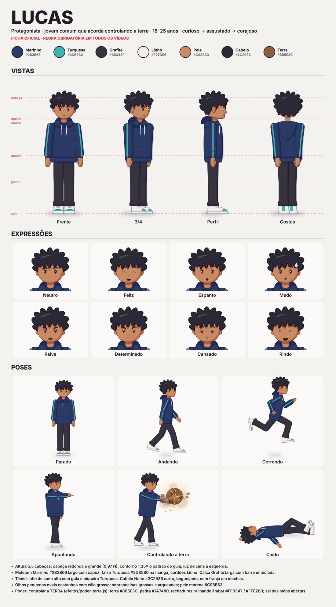

# Lucas — ficha oficial

> **Regra obrigatória:** em todo vídeo, o Lucas aparece exatamente como nesta ficha e em `ficha.jpg`.
> Não mudar proporções, cores, roupa, cabelo, rosto ou poder. Para desenhá-lo, use sempre
> `personagens/lucas/lucas.js` (`criarLucas(opcoes, vista)`) sem passar opções de aparência.
> Qualquer mudança de design precisa ser pedida e aprovada, e aí esta ficha é regerada.



**Quem é:** jovem comum que acorda com o poder de controlar a terra. Idade aparente 18 a 25 anos.
**Personalidade:** curioso, assustado no começo, corajoso depois.
**Origem do design:** versão B2, escolhida na rodada 2 (histórico em `rodadas/`).

## Aparência

| Item | Regra |
|---|---|
| Altura | 5,5 H (H = altura da cabeça) |
| Cabeça | Redonda e grande, largura 0,97 H |
| Contorno | Modo suave (guia, seção 14): borda fina na cor da peça (1,35× × 0,42 do padrão), sombra em degradê e sombra de contato entre peças. Sem contorno preto. |
| Moletom | Marinho `#2B3B66` (sombra `#212A59`, luz `#515C7C`), largo, com capuz enrolado no pescoço e bolso canguru |
| Faixa | Turquesa `#3DB5B0` no lado de fora da manga, do ombro ao punho |
| Cordões | Linho `#F2EDE6`, pontas Pedra `#6A6573` |
| Calça | Grafite `#38343F`, larga, barra embolada |
| Tênis | Linho, cano alto, gola e biqueira Turquesa, sola Linho |
| Pele | Pele 3 (morena) `#C98B63` / sombra `#B75F3F` |
| Cabelo | Cabelo Noite `#2C2936`, curto e bagunçado em cunhas, +10% de volume, franja irregular em mechas, 1 faixa de luz |
| Olhos | Pequenos e ovais (0,10 × 0,14 H), íris Castanho `#6A4330`, cílio superior grosso, 2 brilhos |
| Sobrancelhas | Grossas e arqueadas (0,2 × 0,066 H) |
| Boca | Simples, traço único |

### Linhas de altura (iguais em todas as vistas)
cabeça 0 · queixo 1 H · ombro 1,2 H · quadril 2,75 H · joelho 4 H · sola 5,5 H.

## Vistas (`vistas/`)
| Vista | Código | Observação |
|---|---|---|
| Frente | `'frente'` | — |
| 3/4 | `'tq'` | Olha para a direita; o lado direito do corpo (`_d`) fica perto da câmera |
| Perfil | `'perfil'` | Olha para a direita; nariz e queixo na silhueta |
| Costas | `'costas'` | Capuz deitado nas costas, redemoinho no alto da cabeça |

Para olhar para a esquerda: desenhar com `{ espelhar: true }`.

## Expressões (`expressoes/`)
neutro, feliz, espanto, medo (com gota de suor), raiva, determinado, cansado (olheiras), rindo.
Extras disponíveis: curioso, triste.

## Poses (`poses/`)
| Pose | Código | Vista | Expressão |
|---|---|---|---|
| Parado | `parado` | frente | neutro |
| Andando | `andando` | perfil | neutro |
| Correndo | `correndo` | perfil | determinado |
| Apontando | `apontando` | 3/4 | determinado |
| Controlando a terra | `poder` | 3/4 | determinado + efeito `poder-terra` |
| Caído | `caido` | perfil (deitado) | cansado |

Mãos disponíveis nas poses (`_maos`): relaxada, apontando, aberta, punho.

## Poder
**Controlar o elemento terra** (decisão do autor), arquivo `efeitos/poder-terra.js`:
esfera de terra com textura e rachaduras brilhando, pedras orbitando, poeira e cascalho.
Cores: terra `#8B5E3C` (escura `#5A3A22`, clara `#B07A4E`), pedra `#7A7480`, rachaduras `#FFB347` com miolo `#FFE2B0`.
Funciona em cena clara (cores chapadas) e escura (o brilho das rachaduras aparece mais).

## Exceções ao guia (aprovadas no briefing)
- Marinho como cor-assinatura (~45% da área).
- Olhos menores que o padrão do guia.
- Cabeça mais larga que o padrão (0,97 H em vez de 0,85 H).

## Como regerar
```bash
node motor/ficha.js personagens/lucas/lucas.js efeitos/poder-energia.js personagens/lucas/ficha.json personagens/lucas
```

## Histórico
- Render passou para o modo suave (menos cartunesco), a pedido. O desenho (cores, proporções, roupa, rosto) não mudou; a ficha foi regerada.
- Poder trocado de Energia para **controlar a terra**, a pedido. Ficha regerada.
