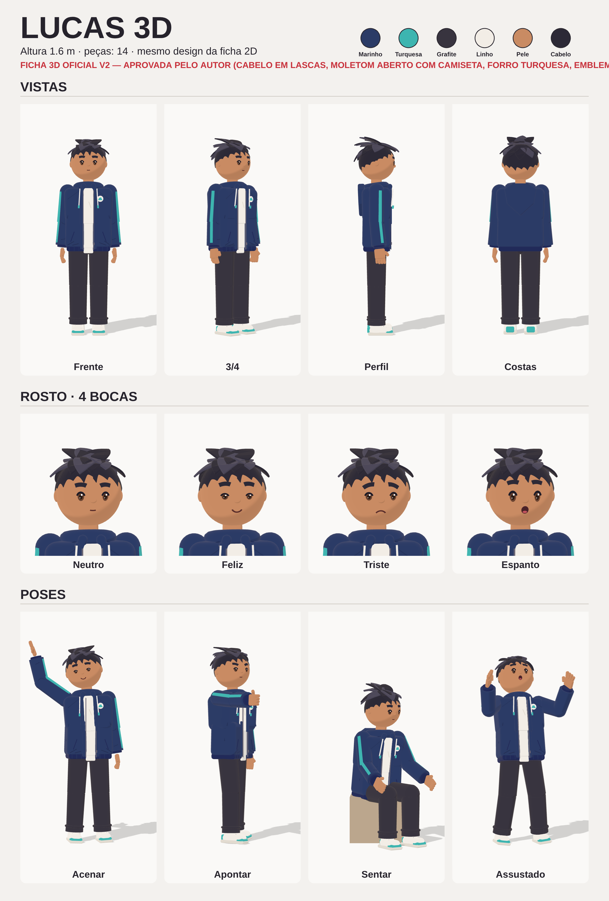

# Lucas 3D — ficha oficial (aprovada)

> Versão 3D do Lucas para o motor novo. **Mesmo design da ficha oficial 2D** (`../ficha.md`): mesmas cores,
> moletom marinho com faixa turquesa, capuz enrolado, cordões linho, calça grafite larga com barra embolada,
> tênis linho de cano alto com detalhes turquesa, pele morena, cabelo noite bagunçado em mechas.
> **Aprovada pelo autor.** No motor 3D, o Lucas é sempre `criarBoneco(ficha.json)`, sem mudar a aparência.
> A ficha 2D continua valendo para o motor 2D.

- **Dados:** `ficha.json` (altura 1,6 m do chão ao topo do cabelo, cores, medidas, peças).
- **Código:** `motor/personagem/boneco.js` → `criarBoneco(ficha)` devolve `{ raiz, juntas, posar(pose), rosto(nome), mao(lado, forma) }`.
- **Juntas:** quadril → coluna → peito → pescoço → cabeça; peito → ombros → cotovelos → mãos; quadril → coxas → joelhos → pés.
- **Rosto:** olhos, sobrancelhas e boca planos sobre a cabeça. Bocas: neutra, sorriso, triste, aberta.
  Expressões: neutro, feliz, triste, espanto, medo, determinado, raiva, cansado.
- **Mãos:** relaxada, aberta, punho, apontando.
- **Poses:** repouso, acenar, apontar, sentar, assustado (`POSES` em `boneco.js`), misturadas com `misturar(a, b, k)`.
- **Poder:** controlar a terra (efeito 3D vem numa etapa seguinte).

Regerar a folha: `node motor/render/quadros.js motor/visual/ficha3d.html --quadros 0 --saida previas/motor3d/ficha3d`
e copiar `quadro_00000.png` para cá como `ficha.png`.
