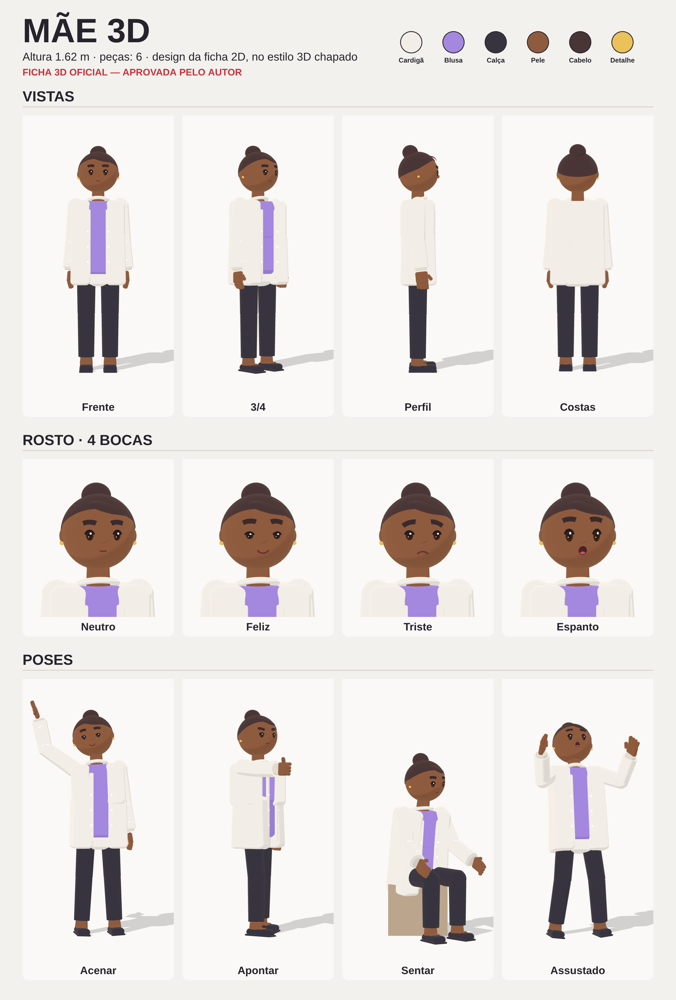

# Mãe 3D — ficha oficial (aprovada)

> Versão 3D no estilo chapado do Lucas 3D (cabeça grande, roupa em blocos, mãos de luva, sombra de desenho),
> seguindo o design da ficha 2D proposta (`../ficha.md`). **Aprovada pelo autor:** no motor 3D, use sempre `criarBoneco(ficha.json)` sem mudar a aparência.

- **Dados:** `ficha.json` (altura, cores, medidas, peças). **Código:** `motor/personagem/boneco.js` → `criarBoneco(ficha)`.
- Mesmas juntas, expressões, mãos e poses do Lucas 3D; funciona com todas as atuações do motor.
