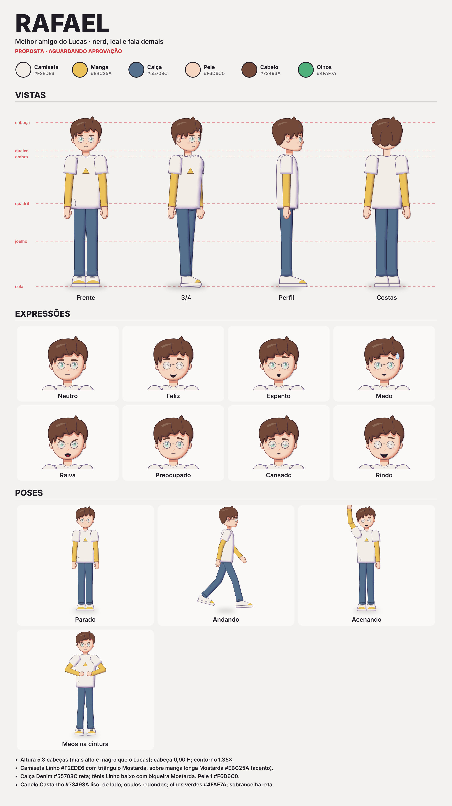

# Rafael — ficha (proposta)

> **Status: proposta, aguardando aprovação.** Depois de aprovada, vira regra obrigatória como a do Lucas.

- Melhor amigo do Lucas. Séries: invisibilidade (`roteiros/invisivel/`) e terra (`roteiros/terra/`).
- Desenho: `personagens/rafael/rafael.js` (função `criarRafael(opcoes, vista)`), montado sobre `motor/personagem-base.js`.
- Vistas: frente, 3/4 (`tq`), perfil, costas — olhando para a direita; espelhar para a esquerda.
- Expressões: neutro, feliz, espanto, medo, raiva, preocupado, cansado, rindo (também: determinado, sério).
- Poses: parado, andando, acenando, mãos na cintura (registro `POSES_PADRAO`).
- Cores e medidas: ver as regras no rodapé de `ficha.png` e as opções no início de `amigo.js`.

Regerar: `node motor/ficha.js motor/personagem-base.js personagens/rafael/rafael.js personagens/rafael/ficha.json personagens/rafael`
